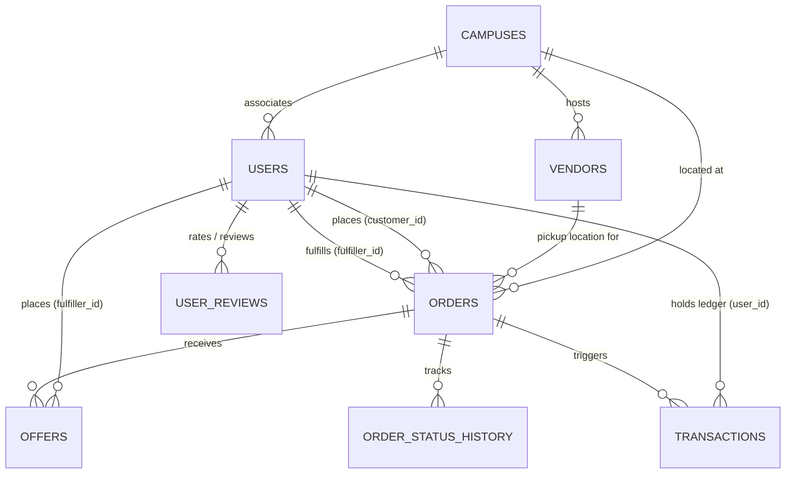
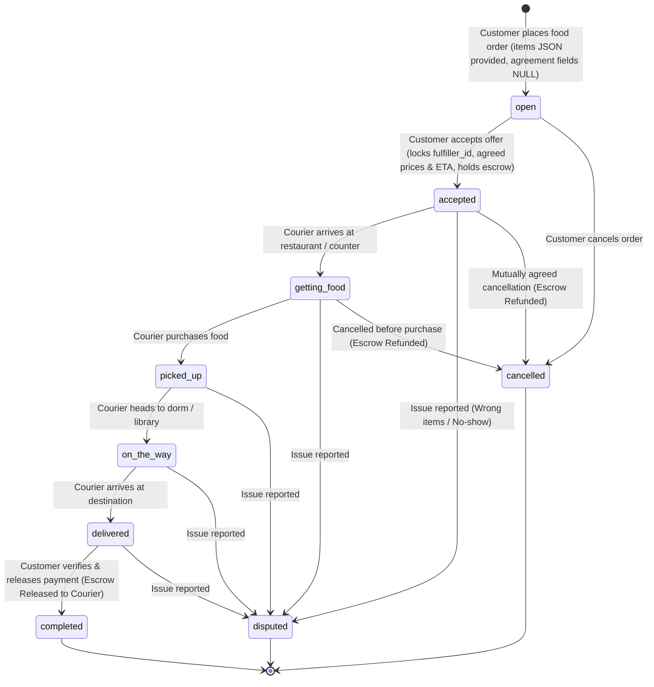

# Database Design & Schema Specification — Dormshi

Derived from the frontend application source code (`src/`), this document specifies the normalized relational database design for **Dormshi**, a campus peer-to-peer food delivery and micro-wallet Mini App running on Telegram's serverless platform.

---

## 1. Domain Overview & Architecture

Dormshi connects campus students placing food orders with student couriers already near campus dining locations. It incorporates an escrow-backed wallet system (ETB / Dormshi Coins "DC") ensuring secure payment releases upon delivery verification.

### Core Domain Subsystems

1. **User & Campus Affiliation**: Telegram user profiles, campus branch assignment, dorm locations, and account settings.
2. **Campus Vendors & Geofence Boundaries**: Registered dining spots (cafes, restaurants, food carts, cafeterias) with physical GPS coordinates (`latitude`, `longitude`) and coverage perimeter radius (`radius_meters`). Couriers outside this geofenced boundary are prevented from claiming or fulfilling orders from that vendor.
3. **Food Orders & Embedded Items**: Delivery orders placed by students linked to a campus vendor. Requested food lines are stored as a structured `items` JSON document. When an offer is accepted, agreement contract terms (`accepted_offer_id`, `fulfiller_id`, `agreed_food_price`, `agreed_delivery_fee`, `agreed_eta_minutes`, `escrow_txn_id`, `accepted_at`) are recorded directly on the order record as nullable fields, and an escrow hold is placed.
4. **Offers & Availability Negotiation**: Student couriers submit bids with store food prices, delivery fees, estimated arrival times (ETA), and an embedded `items` JSON document capturing itemized store availability and unit prices.
5. **Order Tracking & Audit History**: State machine progression from `open` through `delivered`, `completed`, `cancelled`, or `disputed`.
6. **User Balance & Escrow Ledger**: Micro-wallet balances (`main_balance`, `reward_balance`, and `escrow_balance` in default ETB currency) embedded directly in the user profile, backed by immutable audit records in `transactions` for deposits via CBE (verified by transaction ID), escrow holds, releases, peer-to-peer transfers, and withdrawals.
7. **Reviews**: Star ratings and feedback submitted after order completion.

> [!NOTE]
> **Promotional Banners**: Promotional banners and home feed sliders are managed as static client-side configurations (`src/data/orders.ts` -> `adImages`) rather than database rows, keeping the backend schema lean and avoiding unnecessary database queries for marketing assets.

---

## 2. Derived Fields & Normalization Rules

To prevent data anomalies, reduce redundant storage, and maintain third normal form (3NF), **all derived, computed, and client-relative fields from the frontend types and mock data have been excluded from the physical database tables**.

| Field in Frontend Type / Mock | Source / Base Table | Why it is Derived & How to Compute |
| :--- | :--- | :--- |
| `User.initials` (e.g. `'MO'`) | `users.name` | **Derived text**: First letters of the first and last name (`getInitials(name)`). |
| `User.rating` (e.g. `4.9`) | `users.rating` | **Cached aggregate column**: Stored on `users` and updated upon new review creation to avoid full table `AVG()` scans. Default `5.0`. |
| `User.deliveries` (e.g. `23`) | `users.deliveries_count` | **Cached counter column**: Stored on `users` and incremented when an order status reaches `'completed'`. |
| `User.orders` (e.g. `4`) | `users.orders_count` | **Cached counter column**: Stored on `users` and incremented when the user completes an order. |
| `Offer.totalAmount` (e.g. `145.00`) | `offers` | **Derived arithmetic**: `food_price + delivery_fee`. |
| `Offer.availableItems` (`"1 of 2"`) | `offers.items` (JSON) | **Computed in application JS**: Filter items array where `isAvailable === true` vs total length. |
| `Order.totalAmount` | `orders` | **Derived arithmetic**: `agreed_items_price + agreed_delivery_fee`. |
| `FeedOrder.timeAgo` (`"11m ago"`) | `*.created_at` | **Client-side time formatting**: Formatted dynamically relative to client current time. |
| `FeedOrder.isMine` | `orders.user_id` | **Contextual boolean**: `user_id === ctx.initData.user.id`. |
| `OfferData.highlight` (`"Best price"`) | `offers` | **Dynamic ranking**: Ranked by client or query comparator (`ORDER BY total_price ASC`). |
| `adImages` (Banners) | Static Asset | **Static configuration**: Banners and carousel slides are static frontend constants (`src/data/orders.ts`), not database rows. |
| `currency` (`'ETB'`) | System Constant | **Default currency**: All balances and order transactions default strictly to ETB, eliminating redundant `currency` columns. |
| Food Categories Catalog | Static Asset / Endpoint | **Static configuration**: Categorized food options (`drinks`, `meals`, `snacks`) served directly by `foods.categories.js`, requiring no physical database table. |
| `wallets` table | `users` table | **1:1 Merged relation**: Separate wallet table merged directly into `users` (`main_balance`, `reward_balance`, `escrow_balance`) for faster single-row updates without joins. |
| `order_agreements` table | `orders` table | **1:1 Merged relation**: Agreement terms inlined directly into `orders` as nullable fields (`NULL` while open, populated upon offer acceptance). |
| `order_items` & `offer_items` tables | `orders.items` & `offers.items` | **Embedded JSON Documents**: Line items are read as snapshots and never updated independently, so they are stored as JSON arrays directly in `orders` and `offers`. |

---

## 3. Entity-Relationship Diagram (ERD)



---

## 4. Data Dictionary & Table Definitions

> [!NOTE]
> In accordance with the **tgcloud SDK** and SQLite isolate environment, foreign keys (`.references()`) are **not declared at the database engine level**. Relational integrity (cascades, orphan cleanups, insertion order) is enforced in application endpoints.

> [!IMPORTANT]
> **Primary Key Generation Strategy (`crypto.randomUUID()`)**:
> Sequential auto-increment integer IDs (`1, 2, 3...`) are strictly avoided across all tables to prevent ID enumeration attacks and business volume leakage.
> All tables use `TEXT` primary keys generated using the platform's standard **`crypto.randomUUID()`** (UUID v4) inside serverless function endpoints upon insertion (e.g. `'f47ac10b-58cc-4372-a567-0e02b2c3d479'`).

### 4.1. `campuses`
Stores universities and regional campus branches.

| Column | Type | Nullable | Default | Description |
| :--- | :--- | :--- | :--- | :--- |
| `id` | `TEXT` | No | *None (PK)* | Unique campus UUID generated via `crypto.randomUUID()` |
| `name` | `TEXT` | No | - | Short display name (e.g., `'Main'`, `'IoT'`, `'Harar'`) |
| `title` | `TEXT` | No | - | Full campus title (e.g., `'Institute of Technology (IoT)'`) |
| `univ_code` | `TEXT` | No | - | University short code (e.g., `'HRU'`) |
| `univ_name` | `TEXT` | No | - | Full university name (e.g., `'Haramaya University'`) |
| `is_active` | `INTEGER (boolean)` | No | `1` (`true`) | Whether this campus is actively serviced |
| `created_at` | `INTEGER (timestamp)` | No | `(unixepoch())` | Campus record creation timestamp |

**Indexes & Constraints**:
- Primary Key: `id`
- Index: `idx_campuses_univ_code` on `univ_code`

---

### 4.2. `users`
Student profiles, merged wallet balances, and cached stats counters. *Notice: `initials` remains derived from `name`.*

| Column | Type | Nullable | Default | Description |
| :--- | :--- | :--- | :--- | :--- |
| `id` | `TEXT` | No | *None (PK)* | Unique user UUID generated via `crypto.randomUUID()` |
| `tg_id` | `INTEGER` | No | - | Telegram User ID verified from `ctx.initData.user.id` |
| `name` | `TEXT` | No | - | User display name (e.g., `'Maya Okafor'`) |
| `phone` | `TEXT` | Yes | `NULL` | Contact phone number (e.g., `'+251 91 234 5678'`) |
| `campus_id` | `TEXT` | No | - | Campus affiliation (logical FK to `campuses.id`) |
| `is_ambassador` | `INTEGER (boolean)` | No | `0` (`false`) | Whether user is a designated campus ambassador / student lead |
| `main_balance` | `REAL` | No | `0.0` | Liquid wallet balance available in ETB |
| `reward_balance` | `REAL` | No | `0.0` | Reward balance available in ETB (e.g., referral bonuses) |
| `escrow_balance` | `REAL` | No | `0.0` | Escrow balance locked for active in-flight orders in ETB |
| `rating` | `REAL` | No | `5.0` | Cached average rating score (1.0 - 5.0) |
| `deliveries_count` | `INTEGER` | No | `0` | Total completed courier deliveries |
| `orders_count` | `INTEGER` | No | `0` | Total completed food orders placed |
| `created_at` | `INTEGER (timestamp)` | No | `(unixepoch())` | Account creation date |
| `updated_at` | `INTEGER (timestamp)` | No | `(unixepoch())` | Last profile update date |

**Indexes & Constraints**:
- Primary Key: `id`
- Unique Index: `uidx_users_tg_id` on `tg_id`
- Index: `idx_users_campus_id` on `campus_id`
- Index: `idx_users_campus_ambassador` on `campus_id, is_ambassador`
- Check: `chk_user_wallet_non_negative` (`main_balance >= 0.0 AND reward_balance >= 0.0 AND escrow_balance >= 0.0`)

---

### 4.3. `vendors`
Registered campus dining spots (cafes, restaurants, food carts, bakeries, dining halls) with geofence coverage boundaries.

| Column | Type | Nullable | Default | Description |
| :--- | :--- | :--- | :--- | :--- |
| `id` | `TEXT` | No | *None (PK)* | Unique vendor UUID generated via `crypto.randomUUID()` |
| `campus_id` | `TEXT` | No | - | Logical FK to `campuses.id` |
| `name` | `TEXT` | No | - | Vendor name (e.g., `'Tea Lab'`, `'Bean Counter Café'`) |
| `phone` | `TEXT` | Yes | `NULL` | Optional vendor contact number |
| `location_name` | `TEXT` | No | - | Location description (e.g., `'Union Square'`, `'Student Center, 1st Floor'`) |
| `category` | `TEXT` | No | `'restaurant'` | Type: `'cafe'`, `'restaurant'`, `'cart'`, `'bakery'`, `'dining_hall'` |
| `latitude` | `REAL` | No | - | GPS latitude coordinate |
| `longitude` | `REAL` | No | - | GPS longitude coordinate |
| `radius_meters` | `INTEGER` | No | `500` | Geofence perimeter in meters couriers must be within to fulfill orders |
| `is_active` | `INTEGER (boolean)` | No | `1` (`true`) | Whether vendor is open/accepting orders |
| `created_at` | `INTEGER (timestamp)` | No | `(unixepoch())` | Vendor creation date |

**Indexes & Constraints**:
- Primary Key: `id`
- Index: `idx_vendors_campus_active` on `campus_id, is_active`

---

### 4.4. `orders`
Food delivery orders with embedded requested items, optional vendor link, and locked agreement terms. *Notice: agreement columns are `NULL` while `status = 'open'` and populated once an offer is accepted.*

| Column | Type | Nullable | Default | Description |
| :--- | :--- | :--- | :--- | :--- |
| `id` | `TEXT` | No | *None (PK)* | Unique order UUID generated via `crypto.randomUUID()` |
| `user_id` | `TEXT` | No | - | Logical FK to `users.id` (ordering student) |
| `campus_id` | `TEXT` | No | - | Logical FK to `campuses.id` |
| `vendor_id` | `TEXT` | Yes | `NULL` | Logical FK to `vendors.id` if ordered from a registered spot |
| `pickup_location` | `TEXT` | No | - | Name or address of pickup spot (e.g., `'Tea Lab, Union Square'`) |
| `destination` | `TEXT` | No | - | Drop-off building and room (e.g., `'Hartley Hall, 3rd floor lounge'`) |
| `instructions` | `TEXT` | Yes | `NULL` | Delivery notes (e.g., `'Less ice on both please'`) |
| `items` | `TEXT (JSON)` | No | - | JSON array of requested items: `[{"name": string, "quantity": number}]` |
| `status` | `TEXT` | No | `'open'` | Current status (see State Machine section below) |
| `cancel_reason` | `TEXT` | Yes | `NULL` | Cancellation reason if cancelled |
| `dispute_reason` | `TEXT` | Yes | `NULL` | Dispute reason if reported |
| **Agreement Columns** | | | *(Populated upon offer acceptance)* | |
| `accepted_offer_id` | `TEXT` | Yes | `NULL` | Logical FK to accepted `offers.id` |
| `fulfiller_id` | `TEXT` | Yes | `NULL` | Logical FK to `users.id` (accepted student courier) |
| `agreed_items_price` | `REAL` | Yes | `NULL` | Locked food price in ETB |
| `agreed_delivery_fee` | `REAL` | Yes | `NULL` | Locked courier delivery fee in ETB |
| `agreed_eta_minutes` | `INTEGER` | Yes | `NULL` | Agreed estimated arrival time in minutes |
| `escrow_txn_id` | `TEXT` | Yes | `NULL` | Logical FK to `transactions.id` (hold transaction) |
| `accepted_at` | `INTEGER (timestamp)` | Yes | `NULL` | Timestamp when agreement was accepted |
| `created_at` | `INTEGER (timestamp)` | No | `(unixepoch())` | Time posted |
| `updated_at` | `INTEGER (timestamp)` | No | `(unixepoch())` | Last status or term update |

**Indexes & Constraints**:
- Primary Key: `id`
- Index: `idx_orders_campus_status` on `campus_id, status, created_at` (powers campus order feed)
- Index: `idx_orders_user_status` on `user_id, status` (powers "My Orders" tab)
- Index: `idx_orders_fulfiller_status` on `fulfiller_id, status` (powers courier's active deliveries tab)
- Index: `idx_orders_vendor` on `vendor_id` (vendor order lookup)

---

### 4.5. `offers`
Bids made by student couriers willing to purchase and deliver an order. *Notice: `total_amount` is omitted as `items_price + delivery_fee`.*

| Column | Type | Nullable | Default | Description |
| :--- | :--- | :--- | :--- | :--- |
| `id` | `TEXT` | No | *None (PK)* | Unique offer UUID generated via `crypto.randomUUID()` |
| `order_id` | `TEXT` | No | - | Logical FK to `orders.id` |
| `fulfiller_id` | `TEXT` | No | - | Logical FK to `users.id` (courier) |
| `items_price` | `REAL` | No | - | Quoted food cost in ETB |
| `delivery_fee` | `REAL` | No | - | Courier delivery fee in ETB |
| `eta_minutes` | `INTEGER` | No | - | Estimated minutes to delivery (e.g., `15`) |
| `note` | `TEXT` | Yes | `NULL` | Courier note (e.g., `'Already at counter...'`) |
| `items` | `TEXT (JSON)` | No | - | JSON array of item availability & prices: `[{"name": string, "quantity": number, "unitPrice": number}]` |
| `status` | `TEXT` | No | `'pending'` | Offer status: `'pending'`, `'accepted'`, `'completed'` |
| `created_at` | `INTEGER (timestamp)` | No | `(unixepoch())` | Time offer was placed |
| `updated_at` | `INTEGER (timestamp)` | No | `(unixepoch())` | Last update time |

**Indexes & Constraints**:
- Primary Key: `id`
- Index: `idx_offers_order_status` on `order_id, status`
- Index: `idx_offers_fulfiller_status` on `fulfiller_id, status` (powers "Sent Offers" tab)

---

### 4.6. `order_status_history`
Append-only timeline audit events for every milestone in order fulfillment.

| Column | Type | Nullable | Default | Description |
| :--- | :--- | :--- | :--- | :--- |
| `id` | `TEXT` | No | *None (PK)* | Unique audit event UUID generated via `crypto.randomUUID()` |
| `order_id` | `TEXT` | No | - | Logical FK to `orders.id` |
| `status` | `TEXT` | No | - | Status recorded (`'open'`, `'accepted'`, `'pending'`,`'delivered'`, `'cancelled'`, `'disputed'`) |
| `actor_id` | `TEXT` | Yes | `NULL` | Logical FK to `users.id` who triggered the transition |
| `note` | `TEXT` | Yes | `NULL` | Optional transition note or courier update |
| `created_at` | `INTEGER (timestamp)` | No | `(unixepoch())` | Event timestamp |

**Indexes & Constraints**:
- Primary Key: `id`
- Index: `idx_status_history_order` on `order_id, created_at`

---

### 4.7. `transactions`
Complete financial audit ledger (in ETB). Every balance change produces an immutable transaction record linked directly to the user.

| Column | Type | Nullable | Default | Description |
| :--- | :--- | :--- | :--- | :--- |
| `id` | `TEXT` | No | *None (PK)* | Unique transaction UUID generated via `crypto.randomUUID()` |
| `user_id` | `TEXT` | No | - | Logical FK to `users.id` (account owner) |
| `counterparty_id` | `TEXT` | Yes | `NULL` | Logical FK to `users.id` (e.g. peer recipient, courier) |
| `order_id` | `TEXT` | Yes | `NULL` | Logical FK to `orders.id` if order-related |
| `type` | `TEXT` | No | - | `'deposit'`, `'withdrawal'`, `'purchased'`, `'earned'`, `'reward'`, `'transfer'`, `'refund'`, `'reserved'` |
| `amount` | `REAL` | No | - | Transaction amount in ETB |
| `reference` | `TEXT` | Yes | `NULL` | External transaction reference (e.g. CBE Txn ID `'FT2429402941'`) |
| `status` | `TEXT` | No | `'completed'` | Status: `'pending'`, `'completed'`, `'failed'`, `'cancelled'` |
| `created_at` | `INTEGER (timestamp)` | No | `(unixepoch())` | Transaction timestamp |

**Indexes & Constraints**:
- Primary Key: `id`
- Index: `idx_txns_user_created` on `user_id, created_at DESC` (powers Wallet History)
- Unique Index: `uidx_txns_reference` on `reference` (ensures a CBE transaction ID cannot be credited more than once)
- Index: `idx_txns_order_id` on `order_id`

---

### 4.8. `user_reviews`
Courier rating and feedback submitted after order completion. Used to dynamically compute user ratings.

| Column | Type | Nullable | Default | Description |
| :--- | :--- | :--- | :--- | :--- |
| `id` | `TEXT` | No | *None (PK)* | Unique review UUID generated via `crypto.randomUUID()` |
| `order_id` | `TEXT` | No | - | Logical FK to `orders.id` |
| `reviewer_id` | `TEXT` | No | - | Logical FK to `users.id` |
| `reviewee_id` | `TEXT` | No | - | Logical FK to `users.id` (courier being reviewed) |
| `rating` | `INTEGER` | No | - | Rating from 1 to 5 stars |
| `comment` | `TEXT` | Yes | `NULL` | Optional review note |
| `created_at` | `INTEGER (timestamp)` | No | `(unixepoch())` | Review timestamp |

**Indexes & Constraints**:
- Primary Key: `id`
- Index: `idx_reviews_reviewee` on `reviewee_id`
- Check: `chk_review_rating` (`rating >= 1 AND rating <= 5`)

---

## 5. State Machine & Financial Lifecycle

### 5.1. Order Lifecycle



### 5.2. Escrow & Wallet Flow

1. **Offer Accepted**:
   - Total amount computed on the fly: `totalAmount = offer.items_price + offer.delivery_fee`.
   - Customer balance checked: `customer.main_balance >= totalAmount`.
   - Update `users` (customer): `main_balance = main_balance - totalAmount`, `escrow_balance = escrow_balance + totalAmount`.
   - Update `orders`: Set `accepted_offer_id`, `fulfiller_id`, `agreed_items_price`, `agreed_delivery_fee`, `agreed_eta_minutes`, `escrow_txn_id`, `accepted_at`, and `status = 'accepted'`.
   - Create transaction in `transactions`: `type = 'reserved'`, `amount = totalAmount`.
2. **Order Completed & Rated**:
   - Customer confirms delivery at `orders.confirm` and submits courier rating (1–5 stars) and optional review comment.
   - Total amount: `totalAmount = order.agreed_items_price + order.agreed_delivery_fee`.
   - Customer user: `escrow_balance = escrow_balance - totalAmount`, `orders_count = orders_count + 1`.
   - Courier user: `main_balance = main_balance + totalAmount`, `deliveries_count = deliveries_count + 1`, cached `rating` updated.
   - Insert review into `user_reviews`: `reviewer_id = customer.id`, `reviewee_id = order.fulfiller_id`, `rating`, `comment`.
   - Create transactions:
     - Customer: `type = 'purchased'`, `amount = totalAmount`.
     - Courier: `type = 'earned'`, `amount = totalAmount`.
3. **Order Cancelled / Refunded**:
   - Customer user: `escrow_balance = escrow_balance - totalAmount`, `main_balance = main_balance + totalAmount`.
   - Create transaction: `type = 'refund'`, `amount = totalAmount`.

---

## 6. Helper Queries & Geofence Logic

### 6.1. User Profile Query

```sql
SELECT
  u.id,
  u.name,
  -- Initials computed in client JS: getInitials(name)
  u.phone,
  u.campus_id,
  u.is_ambassador,
  u.main_balance,
  u.reward_balance,
  u.escrow_balance,
  u.rating,
  u.deliveries_count,
  u.orders_count
FROM users u
WHERE u.id = ?;
```

### 6.2. Offers with Computed Totals & Items Payload

```sql
SELECT
  o.id,
  o.order_id,
  o.fulfiller_id,
  o.items_price,
  o.delivery_fee,
  (o.items_price + o.delivery_fee) AS total_amount,
  o.eta_minutes,
  o.note,
  o.items, -- Automatically parsed from JSON by the tgcloud SDK
  o.status,
  o.created_at
FROM offers o
WHERE o.order_id = ?;
```

### 6.3. Fulfiller Geofence Validation

When a student courier submits a delivery offer for an order linked to a vendor, application endpoints verify that the courier's current GPS location is within the vendor's geofenced perimeter:

```javascript
/**
 * Haversine distance in meters between courier GPS and vendor location
 */
function isCourierWithinVendorGeofence(courierLat, courierLon, vendor) {
  const R = 6371000; // Earth's radius in meters
  const dLat = ((vendor.latitude - courierLat) * Math.PI) / 180;
  const dLon = ((vendor.longitude - courierLon) * Math.PI) / 180;
  const a =
    Math.sin(dLat / 2) * Math.sin(dLat / 2) +
    Math.cos((courierLat * Math.PI) / 180) *
      Math.cos((vendor.latitude * Math.PI) / 180) *
      Math.sin(dLon / 2) *
      Math.sin(dLon / 2);
  const c = 2 * Math.atan2(Math.sqrt(a), Math.sqrt(1 - a));
  const distanceMeters = R * c;

  return distanceMeters <= vendor.radiusMeters;
}
```

If `isCourierWithinVendorGeofence(...)` returns `false`, the endpoint throws:

```javascript
throw new EndpointError(
  `You must be within ${vendor.radiusMeters}m of ${vendor.name} to submit a delivery offer.`,
  {
    code: "OUTSIDE_VENDOR_GEOFENCE",
  },
);
```
