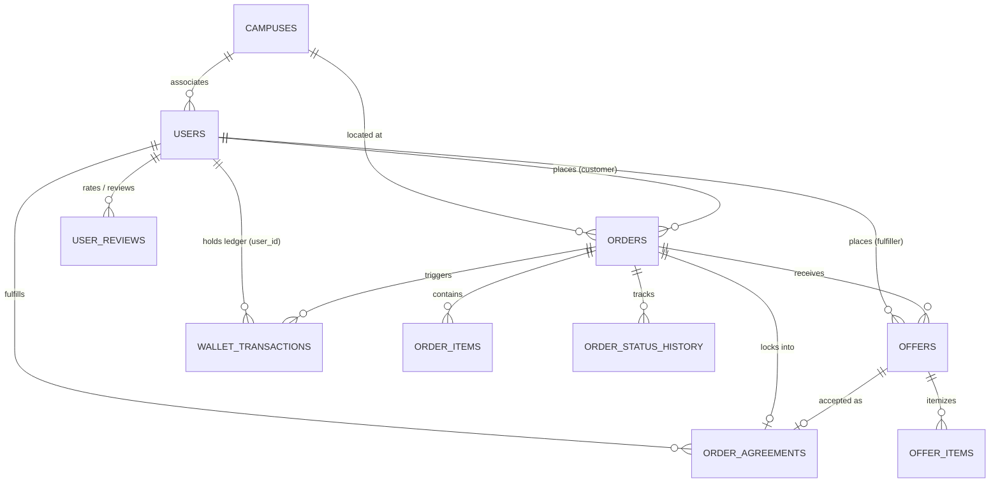
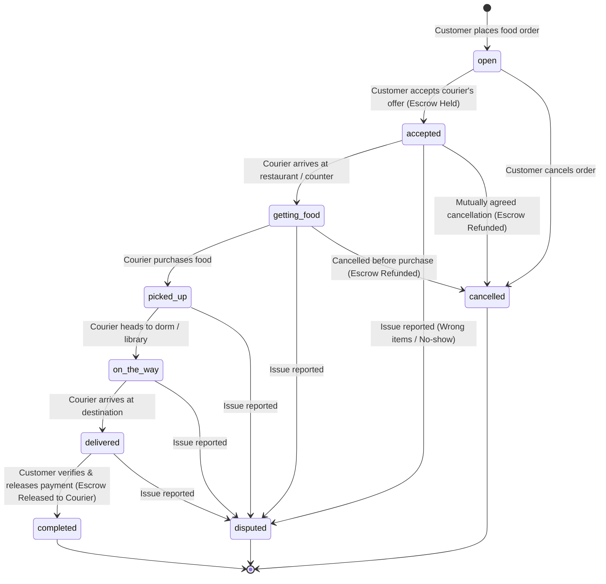

# Database Design & Schema Specification — Dormshi

Derived from the frontend application source code (`src/`), this document specifies the normalized relational database design for **Dormshi**, a campus peer-to-peer food delivery and micro-wallet Mini App running on Telegram's serverless platform.

---

## 1. Domain Overview & Architecture

Dormshi connects campus students placing food orders with student couriers already near campus dining locations. It incorporates an escrow-backed wallet system (ETB / Dormshi Coins "DC") ensuring secure payment releases upon delivery verification.

### Core Domain Subsystems

1. **User & Campus Affiliation**: Telegram user profiles, campus branch assignment, dorm locations, and account settings.
2. **Food Orders & Line Items**: Delivery orders placed by students with target pick-up spots, destinations, special instructions, and requested item lists.
3. **Offers & Availability Negotiation**: Student couriers submit offers specifying verified item availability, store food prices, delivery fees, and estimated arrival times (ETA).
4. **Order Agreements**: Contractual terms locked upon offer acceptance (escrow hold placed for the locked amount).
5. **Order Tracking & Audit History**: State machine progression from `open` through `delivered`, `completed`, `cancelled`, or `disputed`.
6. **User Balance & Escrow Ledger**: Micro-wallet balances (`wallet_available` vs `wallet_reserved` in default ETB currency) embedded directly in the user profile, backed by immutable audit records in `wallet_transactions` for deposits (CBE Birr, Telebirr), escrow holds, releases, peer-to-peer transfers, and withdrawals.
7. **Reviews**: Star ratings and feedback submitted after order completion.

> [!NOTE]
> **Promotional Banners**: Promotional banners and home feed sliders are managed as static client-side configurations (`src/data/orders.ts` -> `adImages`) rather than database rows, keeping the backend schema lean and avoiding unnecessary database queries for marketing assets.

---

## 2. Derived Fields & Normalization Rules

To prevent data anomalies, reduce redundant storage, and maintain third normal form (3NF), **all derived, computed, and client-relative fields from the frontend types and mock data have been excluded from the physical database tables**.

| Field in Frontend Type / Mock | Source / Base Table | Why it is Derived & How to Compute |
| :--- | :--- | :--- |
| `User.initials` (e.g. `'MO'`) | `users.name` | **Derived text**: First letters of the first and last name (`getInitials(name)`). |
| `User.rating` (e.g. `4.9`) | `user_reviews` | **Derived aggregate**: `COALESCE(AVG(rating), 5.0)` from `user_reviews WHERE reviewee_id = users.id`. |
| `User.ratingCount` | `user_reviews` | **Derived aggregate**: `COUNT(*)` from `user_reviews WHERE reviewee_id = users.id`. |
| `User.deliveries` (e.g. `23`) | `order_agreements` + `orders` | **Derived count**: `COUNT(*)` from `order_agreements oa JOIN orders o ON oa.order_id = o.id WHERE oa.fulfiller_id = users.id AND o.status = 'completed'`. |
| `User.orders` (e.g. `4`) | `orders` | **Derived count**: `COUNT(*)` from `orders WHERE customer_id = users.id AND status = 'completed'`. |
| `Offer.totalAmount` (e.g. `145.00`) | `offers` | **Derived arithmetic**: `food_price + delivery_fee`. |
| `Offer.availableItems` (`"1 of 2"`) | `offer_items` | **Derived count**: `COUNT(CASE WHEN is_available THEN 1 END) \|\| ' of ' \|\| COUNT(*)`. |
| `OfferItem.totalPrice` | `offer_items` | **Derived arithmetic**: `quantity * unit_price`. |
| `Agreement.totalAmount` | `order_agreements` | **Derived arithmetic**: `food_price + delivery_fee`. |
| `Agreement.customerId` | `orders` | **Redundant relation**: Already stored in `orders.customer_id` for that `order_id`. |
| `FeedOrder.timeAgo` (`"11m ago"`) | `*.created_at` | **Client-side time formatting**: Formatted dynamically relative to client current time. |
| `FeedOrder.isMine` | `orders.customer_id` | **Contextual boolean**: `customer_id === ctx.initData.user.id`. |
| `OfferData.highlight` (`"Best price"`) | `offers` | **Dynamic ranking**: Ranked by client or query comparator (`ORDER BY total_price ASC`). |
| `adImages` (Banners) | Static Asset | **Static configuration**: Banners and carousel slides are static frontend constants (`src/data/orders.ts`), not database rows. |
| `currency` (`'ETB'`) | System Constant | **Default currency**: All balances and order transactions default strictly to ETB, eliminating redundant `currency` columns. |
| `wallets` table | `users` table | **1:1 Merged relation**: Separate wallet table merged directly into `users` (`wallet_available`, `wallet_reserved`) for faster single-row updates without joins. |

---

## 3. Entity-Relationship Diagram (ERD)



---

## 4. Data Dictionary & Table Definitions

> [!NOTE]
> In accordance with the **tgcloud SDK** and SQLite isolate environment, foreign keys (`.references()`) are **not declared at the database engine level**. Relational integrity (cascades, orphan cleanups, insertion order) is enforced in application endpoints.

### 4.1. `campuses`
Stores universities and regional campus branches.

| Column | Type | Nullable | Default | Description |
| :--- | :--- | :--- | :--- | :--- |
| `id` | `TEXT` | No | *None (PK)* | Unique campus identifier (e.g., `'hru-main'`, `'hru-iot'`) |
| `name` | `TEXT` | No | - | Short display name (e.g., `'Main'`, `'IoT'`, `'Harar'`) |
| `title` | `TEXT` | No | - | Full campus title (e.g., `'Institute of Technology (IoT)'`) |
| `univ_code` | `TEXT` | No | - | University short code (e.g., `'HRU'`) |
| `univ_name` | `TEXT` | No | - | Full university name (e.g., `'Haramaya University'`) |
| `is_active` | `INTEGER (boolean)` | No | `1` (`true`) | Whether this campus is actively serviced |
| `created_at` | `INTEGER (timestamp)` | No | `(unixepoch())` | Campus record creation timestamp |

**Indexes & Constraints**:
- Primary Key: `id`
- Index: `idx_campuses_univ_code` on `univ_code`

---

### 4.2. `users`
Student profiles and merged wallet balances. *Notice: `initials`, `rating`, `rating_count`, `deliveries_count`, and `orders_count` are omitted as they are derived.*

| Column | Type | Nullable | Default | Description |
| :--- | :--- | :--- | :--- | :--- |
| `id` | `TEXT` | No | *None (PK)* | Internal user ID (e.g., `'u_me'`, or CUID) |
| `tg_id` | `INTEGER` | No | - | Telegram User ID verified from `ctx.initData.user.id` |
| `username` | `TEXT` | Yes | `NULL` | Telegram username without `@` |
| `name` | `TEXT` | No | - | User display name (e.g., `'Maya Okafor'`) |
| `phone` | `TEXT` | Yes | `NULL` | Contact phone number (e.g., `'+251 91 234 5678'`) |
| `avatar_url` | `TEXT` | Yes | `NULL` | Avatar image URL |
| `campus_id` | `TEXT` | No | `'hru-main'` | Default/selected campus |
| `dorm` | `TEXT` | Yes | `NULL` | Dormitory / hall name (e.g., `'Hartley Hall 1A'`) |
| `wallet_available` | `REAL` | No | `0.0` | Liquid wallet balance available in ETB |
| `wallet_reserved` | `REAL` | No | `0.0` | Escrow amount locked for active in-flight orders in ETB |
| `created_at` | `INTEGER (timestamp)` | No | `(unixepoch())` | Account creation date |
| `updated_at` | `INTEGER (timestamp)` | No | `(unixepoch())` | Last profile update date |

**Indexes & Constraints**:
- Primary Key: `id`
- Unique Index: `uidx_users_tg_id` on `tg_id`
- Index: `idx_users_campus_id` on `campus_id`
- Check: `chk_user_wallet_non_negative` (`wallet_available >= 0.0 AND wallet_reserved >= 0.0`)

---

### 4.3. `orders`
Food delivery orders placed by students.

| Column | Type | Nullable | Default | Description |
| :--- | :--- | :--- | :--- | :--- |
| `id` | `TEXT` | No | *None (PK)* | Unique order ID (e.g., `'r1'`, `'r2'`, or `'DMS-4HXP2M'`) |
| `customer_id` | `TEXT` | No | - | Logical FK to `users.id` (ordering student) |
| `campus_id` | `TEXT` | No | - | Logical FK to `campuses.id` |
| `pickup_location` | `TEXT` | No | - | Restaurant or campus store name (e.g., `'Tea Lab, Union Square'`) |
| `destination` | `TEXT` | No | - | Drop-off building and room (e.g., `'Hartley Hall, 3rd floor lounge'`) |
| `instructions` | `TEXT` | Yes | `NULL` | Delivery notes (e.g., `'Less ice on both please'`) |
| `image_url` | `TEXT` | Yes | `NULL` | Optional reference photo for food / receipt |
| `payment_method` | `TEXT` | No | `'dc_wallet'` | Payment method: `'dc_wallet'` |
| `status` | `TEXT` | No | `'open'` | Current status (see State Machine section below) |
| `distance_km` | `REAL` | No | `0.0` | Distance in kilometers between pickup and drop-off |
| `cancel_reason` | `TEXT` | Yes | `NULL` | Cancellation reason if cancelled |
| `dispute_reason` | `TEXT` | Yes | `NULL` | Dispute reason if reported |
| `receipt_ref` | `TEXT` | Yes | `NULL` | Human-readable receipt code (e.g., `'DMS-4HXP2M'`) |
| `created_at` | `INTEGER (timestamp)` | No | `(unixepoch())` | Time posted |
| `updated_at` | `INTEGER (timestamp)` | No | `(unixepoch())` | Last status or term update |

**Indexes & Constraints**:
- Primary Key: `id`
- Index: `idx_orders_campus_status` on `campus_id, status, created_at` (powers campus order feed)
- Index: `idx_orders_customer_status` on `customer_id, status` (powers "My Orders" tab)

---

### 4.4. `order_items`
Itemized food lines requested within an order.

| Column | Type | Nullable | Default | Description |
| :--- | :--- | :--- | :--- | :--- |
| `id` | `INTEGER` | No | *Autoincrement PK* | Primary key |
| `order_id` | `TEXT` | No | - | Logical FK to `orders.id` |
| `name` | `TEXT` | No | - | Item name (e.g., `'Taro milk tea'`) |
| `quantity` | `INTEGER` | No | `1` | Desired item quantity |
| `estimated_price` | `REAL` | Yes | `NULL` | Estimated unit price if specified by customer |

**Indexes & Constraints**:
- Primary Key: `id`
- Index: `idx_order_items_order_id` on `order_id`

---

### 4.5. `offers`
Bids made by student couriers willing to purchase and deliver an order. *Notice: `total_amount` is omitted as `food_price + delivery_fee`.*

| Column | Type | Nullable | Default | Description |
| :--- | :--- | :--- | :--- | :--- |
| `id` | `TEXT` | No | *None (PK)* | Unique offer ID (e.g., `'off_1'`, `'off_sent_1'`) |
| `order_id` | `TEXT` | No | - | Logical FK to `orders.id` |
| `fulfiller_id` | `TEXT` | No | - | Logical FK to `users.id` (courier) |
| `food_price` | `REAL` | No | - | Quoted food cost in ETB |
| `delivery_fee` | `REAL` | No | - | Courier delivery fee in ETB |
| `eta_minutes` | `INTEGER` | No | - | Estimated minutes to delivery (e.g., `15`) |
| `note` | `TEXT` | Yes | `NULL` | Courier note (e.g., `'Already at counter...'`) |
| `status` | `TEXT` | No | `'pending'` | Offer status: `'pending'`, `'accepted'`, `'rejected'`, `'withdrawn'`, `'completed'` |
| `created_at` | `INTEGER (timestamp)` | No | `(unixepoch())` | Time offer was placed |
| `updated_at` | `INTEGER (timestamp)` | No | `(unixepoch())` | Last update time |

**Indexes & Constraints**:
- Primary Key: `id`
- Index: `idx_offers_order_status` on `order_id, status`
- Index: `idx_offers_fulfiller_status` on `fulfiller_id, status` (powers "Sent Offers" tab)

---

### 4.6. `offer_items`
Availability and price breakdown per item submitted in an offer. *Notice: `total_price` is omitted as `quantity * unit_price`.*

| Column | Type | Nullable | Default | Description |
| :--- | :--- | :--- | :--- | :--- |
| `id` | `INTEGER` | No | *Autoincrement PK* | Primary key |
| `offer_id` | `TEXT` | No | - | Logical FK to `offers.id` |
| `name` | `TEXT` | No | - | Item name |
| `quantity` | `INTEGER` | No | `1` | Item quantity covered |
| `unit_price` | `REAL` | No | `0.0` | Verified unit price at store |
| `is_available` | `INTEGER (boolean)` | No | `1` (`true`) | Whether item is in stock at restaurant |
| `note` | `TEXT` | Yes | `NULL` | Item-specific substitution/out-of-stock note |

**Indexes & Constraints**:
- Primary Key: `id`
- Index: `idx_offer_items_offer_id` on `offer_id`

---

### 4.7. `order_agreements`
The immutable contractual terms locked when a customer accepts an offer. *Notice: `customer_id` is omitted (read from `orders`) and `total_amount` is omitted (`food_price + delivery_fee`).*

| Column | Type | Nullable | Default | Description |
| :--- | :--- | :--- | :--- | :--- |
| `id` | `TEXT` | No | *None (PK)* | Unique agreement ID |
| `order_id` | `TEXT` | No | - | Logical FK to `orders.id` (Unique) |
| `offer_id` | `TEXT` | No | - | Logical FK to accepted `offers.id` |
| `fulfiller_id` | `TEXT` | No | - | Logical FK to `users.id` (courier) |
| `food_price` | `REAL` | No | - | Locked food price |
| `delivery_fee` | `REAL` | No | - | Locked delivery fee |
| `eta_minutes` | `INTEGER` | No | - | Agreed arrival time in minutes |
| `payment_method` | `TEXT` | No | `'dc_wallet'` | Payment method |
| `escrow_txn_id` | `TEXT` | Yes | `NULL` | Logical FK to `wallet_transactions.id` (hold transaction) |
| `accepted_at` | `INTEGER (timestamp)` | No | `(unixepoch())` | Time agreement was accepted |

**Indexes & Constraints**:
- Primary Key: `id`
- Unique Index: `uidx_agreements_order_id` on `order_id`
- Index: `idx_agreements_fulfiller` on `fulfiller_id`

---

### 4.8. `order_status_history`
Append-only timeline audit events for every milestone in order fulfillment.

| Column | Type | Nullable | Default | Description |
| :--- | :--- | :--- | :--- | :--- |
| `id` | `INTEGER` | No | *Autoincrement PK* | Primary key |
| `order_id` | `TEXT` | No | - | Logical FK to `orders.id` |
| `status` | `TEXT` | No | - | Status recorded (`'open'`, `'accepted'`, `'getting_food'`, `'picked_up'`, `'on_the_way'`, `'delivered'`, `'completed'`, `'cancelled'`, `'disputed'`) |
| `actor_id` | `TEXT` | Yes | `NULL` | Logical FK to `users.id` who triggered the transition |
| `note` | `TEXT` | Yes | `NULL` | Optional transition note or courier update |
| `created_at` | `INTEGER (timestamp)` | No | `(unixepoch())` | Event timestamp |

**Indexes & Constraints**:
- Primary Key: `id`
- Index: `idx_status_history_order` on `order_id, created_at`

---

### 4.9. `wallet_transactions`
Complete financial audit ledger (in ETB). Every balance change produces an immutable transaction record linked directly to the user.

| Column | Type | Nullable | Default | Description |
| :--- | :--- | :--- | :--- | :--- |
| `id` | `TEXT` | No | *None (PK)* | Unique transaction ID (e.g., `'tx_01'`, `'tx_09'`) |
| `user_id` | `TEXT` | No | - | Logical FK to `users.id` (account owner) |
| `counterparty_id` | `TEXT` | Yes | `NULL` | Logical FK to `users.id` (e.g. peer recipient, courier) |
| `order_id` | `TEXT` | Yes | `NULL` | Logical FK to `orders.id` if order-related |
| `type` | `TEXT` | No | - | `'deposit'`, `'cashout'`, `'ordered'`, `'earned'`, `'reward'`, `'send'`, `'refund'`, `'reserved'`, `'released'` |
| `direction` | `TEXT` | No | - | `'in'` (credit), `'out'` (debit), `'hold'` (escrow lock) |
| `amount` | `REAL` | No | - | Transaction amount in ETB |
| `label` | `TEXT` | No | - | User-friendly summary (e.g., `'Taro milk tea · In escrow'`, `'Deposit · CBE Birr'`) |
| `reference` | `TEXT` | Yes | `NULL` | Bank / payment reference (e.g. CBE Txn ID `1000492817263`) |
| `method` | `TEXT` | Yes | `NULL` | Payment channel (`'Telebirr'`, `'CBE Birr'`, `'Bank Card'`, `'dc_wallet'`) |
| `status` | `TEXT` | No | `'completed'` | Status: `'pending'`, `'completed'`, `'failed'`, `'cancelled'` |
| `created_at` | `INTEGER (timestamp)` | No | `(unixepoch())` | Transaction timestamp |

**Indexes & Constraints**:
- Primary Key: `id`
- Index: `idx_txns_user_created` on `user_id, created_at DESC` (powers Wallet History)
- Index: `idx_txns_reference` on `reference` (quick lookup for CBE / Telebirr receipt verifications)
- Index: `idx_txns_order_id` on `order_id`

---

### 4.10. `user_reviews`
Courier rating and feedback submitted after order completion. Used to dynamically compute user ratings.

| Column | Type | Nullable | Default | Description |
| :--- | :--- | :--- | :--- | :--- |
| `id` | `INTEGER` | No | *Autoincrement PK* | Review ID |
| `order_id` | `TEXT` | No | - | Logical FK to `orders.id` |
| `reviewer_id` | `TEXT` | No | - | Logical FK to `users.id` |
| `reviewee_id` | `TEXT` | No | - | Logical FK to `users.id` (courier being reviewed) |
| `rating` | `INTEGER` | No | - | Rating from 1 to 5 stars |
| `comment` | `TEXT` | Yes | `NULL` | Optional review note |
| `created_at` | `INTEGER (timestamp)` | No | `(unixepoch())` | Review timestamp |

**Indexes & Constraints**:
- Primary Key: `id`
- Index: `idx_reviews_reviewee` on `reviewee_id`
- Check: `chk_review_rating` (`rating >= 1 AND rating <= 5`)

---

## 5. State Machine & Financial Lifecycle

### 5.1. Order Lifecycle



### 5.2. Escrow & Wallet Flow

1. **Offer Accepted**:
   - Total amount computed on the fly: `totalAmount = offer.food_price + offer.delivery_fee`.
   - Customer balance checked: `customer.wallet_available >= totalAmount`.
   - `wallet_available = wallet_available - totalAmount`
   - `wallet_reserved = wallet_reserved + totalAmount`
   - Create transaction: `type = 'ordered'`, `direction = 'hold'`.
2. **Order Completed**:
   - Customer confirms delivery at `/orders/:id/confirm`.
   - Customer user: `wallet_reserved = wallet_reserved - totalAmount`.
   - Courier user: `wallet_available = wallet_available + totalAmount`.
   - Create transactions:
     - Customer: `type = 'ordered'`, `direction = 'out'`.
     - Courier: `type = 'earned'`, `direction = 'in'`.
3. **Order Cancelled / Refunded**:
   - Customer user: `wallet_reserved = wallet_reserved - totalAmount`, `wallet_available = wallet_available + totalAmount`.
   - Create transaction: `type = 'refund'`, `direction = 'in'`.

---

## 6. Implementation: `tgcloud/schema.js`

Normalized schema descriptor code for [`tgcloud/schema.js`](file:///home/dagimafro/Documents/AntsarStudio/dormshi/tgcloud/schema.js) using `@tgcloud/sdk`. All derived columns have been stripped and orders naming adopted.

```javascript
import {
  table,
  integer,
  text,
  real,
  boolean,
  index,
  uniqueIndex,
  check,
  sql
} from 'sdk/db';

// 1. Campuses
export const campuses = table('campuses', {
  id: text('id').primaryKey(),
  name: text('name').notNull(),
  title: text('title').notNull(),
  univCode: text('univ_code').notNull(),
  univName: text('univ_name').notNull(),
  isActive: boolean('is_active').default(true),
  createdAt: integer('created_at', { mode: 'timestamp' }).default(sql`(unixepoch())`),
}, (t) => ({
  univCodeIdx: index('idx_campuses_univ_code').on(t.univCode),
}));

// 2. Users (derived initials, ratings, and stats counters removed; wallet balances inlined)
export const users = table('users', {
  id: text('id').primaryKey(),
  tgId: integer('tg_id').notNull(),
  username: text('username'),
  name: text('name').notNull(),
  phone: text('phone'),
  avatarUrl: text('avatar_url'),
  campusId: text('campus_id').notNull().default('hru-main'),
  dorm: text('dorm'),
  walletAvailable: real('wallet_available').notNull().default(0.0),
  walletReserved: real('wallet_reserved').notNull().default(0.0),
  createdAt: integer('created_at', { mode: 'timestamp' }).default(sql`(unixepoch())`),
  updatedAt: integer('updated_at', { mode: 'timestamp' }).default(sql`(unixepoch())`),
}, (t) => ({
  tgIdUidx: uniqueIndex('uidx_users_tg_id').on(t.tgId),
  campusIdx: index('idx_users_campus_id').on(t.campusId),
  walletNonNegChk: check('chk_user_wallet_non_negative', sql`${t.walletAvailable} >= 0.0 AND ${t.walletReserved} >= 0.0`),
}));

// 3. Orders
export const orders = table('orders', {
  id: text('id').primaryKey(),
  customerId: text('customer_id').notNull(),
  campusId: text('campus_id').notNull(),
  pickupLocation: text('pickup_location').notNull(),
  destination: text('destination').notNull(),
  instructions: text('instructions'),
  imageUrl: text('image_url'),
  paymentMethod: text('payment_method').notNull().default('dc_wallet'),
  status: text('status').notNull().default('open'),
  distanceKm: real('distance_km').notNull().default(0.0),
  cancelReason: text('cancel_reason'),
  disputeReason: text('dispute_reason'),
  receiptRef: text('receipt_ref'),
  createdAt: integer('created_at', { mode: 'timestamp' }).default(sql`(unixepoch())`),
  updatedAt: integer('updated_at', { mode: 'timestamp' }).default(sql`(unixepoch())`),
}, (t) => ({
  campusFeedIdx: index('idx_orders_campus_status').on(t.campusId, t.status, t.createdAt),
  customerIdx: index('idx_orders_customer_status').on(t.customerId, t.status),
}));

// 4. Order Items
export const orderItems = table('order_items', {
  id: integer('id').primaryKey({ autoIncrement: true }),
  orderId: text('order_id').notNull(),
  name: text('name').notNull(),
  quantity: integer('quantity').notNull().default(1),
  estimatedPrice: real('estimated_price'),
}, (t) => ({
  orderItemIdx: index('idx_order_items_order_id').on(t.orderId),
}));

// 5. Offers (total_amount removed: foodPrice + deliveryFee)
export const offers = table('offers', {
  id: text('id').primaryKey(),
  orderId: text('order_id').notNull(),
  fulfillerId: text('fulfiller_id').notNull(),
  foodPrice: real('food_price').notNull(),
  deliveryFee: real('delivery_fee').notNull(),
  etaMinutes: integer('eta_minutes').notNull(),
  note: text('note'),
  status: text('status').notNull().default('pending'),
  createdAt: integer('created_at', { mode: 'timestamp' }).default(sql`(unixepoch())`),
  updatedAt: integer('updated_at', { mode: 'timestamp' }).default(sql`(unixepoch())`),
}, (t) => ({
  orderOffersIdx: index('idx_offers_order_status').on(t.orderId, t.status),
  fulfillerOffersIdx: index('idx_offers_fulfiller_status').on(t.fulfillerId, t.status),
}));

// 6. Offer Items (total_price removed: quantity * unitPrice)
export const offerItems = table('offer_items', {
  id: integer('id').primaryKey({ autoIncrement: true }),
  offerId: text('offer_id').notNull(),
  name: text('name').notNull(),
  quantity: integer('quantity').notNull().default(1),
  unitPrice: real('unit_price').notNull().default(0.0),
  isAvailable: boolean('is_available').default(true),
  note: text('note'),
}, (t) => ({
  offerIdx: index('idx_offer_items_offer_id').on(t.offerId),
}));

// 7. Order Agreements (total_amount and redundant customerId removed)
export const orderAgreements = table('order_agreements', {
  id: text('id').primaryKey(),
  orderId: text('order_id').notNull(),
  offerId: text('offer_id').notNull(),
  fulfillerId: text('fulfiller_id').notNull(),
  foodPrice: real('food_price').notNull(),
  deliveryFee: real('delivery_fee').notNull(),
  etaMinutes: integer('eta_minutes').notNull(),
  paymentMethod: text('payment_method').notNull().default('dc_wallet'),
  escrowTxnId: text('escrow_txn_id'),
  acceptedAt: integer('accepted_at', { mode: 'timestamp' }).default(sql`(unixepoch())`),
}, (t) => ({
  orderUidx: uniqueIndex('uidx_agreements_order_id').on(t.orderId),
  fulfillerIdx: index('idx_agreements_fulfiller').on(t.fulfillerId),
}));

// 8. Order Status History
export const orderStatusHistory = table('order_status_history', {
  id: integer('id').primaryKey({ autoIncrement: true }),
  orderId: text('order_id').notNull(),
  status: text('status').notNull(),
  actorId: text('actor_id'),
  note: text('note'),
  createdAt: integer('created_at', { mode: 'timestamp' }).default(sql`(unixepoch())`),
}, (t) => ({
  timelineIdx: index('idx_status_history_order').on(t.orderId, t.createdAt),
}));

// 9. Wallet Transactions
export const walletTransactions = table('wallet_transactions', {
  id: text('id').primaryKey(),
  userId: text('user_id').notNull(),
  counterpartyId: text('counterparty_id'),
  orderId: text('order_id'),
  type: text('type').notNull(),
  direction: text('direction').notNull(),
  amount: real('amount').notNull(),
  label: text('label').notNull(),
  reference: text('reference'),
  method: text('method'),
  status: text('status').notNull().default('completed'),
  createdAt: integer('created_at', { mode: 'timestamp' }).default(sql`(unixepoch())`),
}, (t) => ({
  userHistoryIdx: index('idx_txns_user_created').on(t.userId, t.createdAt),
  referenceIdx: index('idx_txns_reference').on(t.reference),
  orderTxnIdx: index('idx_txns_order_id').on(t.orderId),
}));

// 10. User Reviews
export const userReviews = table('user_reviews', {
  id: integer('id').primaryKey({ autoIncrement: true }),
  orderId: text('order_id').notNull(),
  reviewerId: text('reviewer_id').notNull(),
  revieweeId: text('reviewee_id').notNull(),
  rating: integer('rating').notNull(),
  comment: text('comment'),
  createdAt: integer('created_at', { mode: 'timestamp' }).default(sql`(unixepoch())`),
}, (t) => ({
  revieweeIdx: index('idx_reviews_reviewee').on(t.revieweeId),
  ratingChk: check('chk_review_rating', sql`${t.rating} >= 1 AND ${t.rating} <= 5`),
}));
```

---

## 7. Derivation Queries & SQL Views

For endpoints needing these computed fields, use these standard queries rather than storing stale columns:

### 7.1. User Profile with Computed Initials, Rating & Stats
```sql
SELECT 
  u.id,
  u.name,
  -- Initials computed in client JS: getInitials(name)
  u.phone,
  u.campus_id,
  u.dorm,
  u.wallet_available,
  u.wallet_reserved,
  COALESCE(AVG(r.rating), 5.0) AS rating,
  COUNT(DISTINCT r.id) AS rating_count,
  (SELECT COUNT(*) FROM order_agreements oa 
   JOIN orders o ON oa.order_id = o.id 
   WHERE oa.fulfiller_id = u.id AND o.status = 'completed') AS deliveries_count,
  (SELECT COUNT(*) FROM orders o 
   WHERE o.customer_id = u.id AND o.status = 'completed') AS orders_count
FROM users u
LEFT JOIN user_reviews r ON r.reviewee_id = u.id
WHERE u.id = ?
GROUP BY u.id;
```

### 7.2. Offers with Computed Totals & Stock Counts
```sql
SELECT 
  o.id,
  o.order_id,
  o.fulfiller_id,
  o.food_price,
  o.delivery_fee,
  (o.food_price + o.delivery_fee) AS total_amount,
  o.eta_minutes,
  o.note,
  o.status,
  COUNT(CASE WHEN oi.is_available = 1 THEN 1 END) AS available_items_count,
  COUNT(oi.id) AS total_items_count
FROM offers o
LEFT JOIN offer_items oi ON oi.offer_id = o.id
WHERE o.order_id = ?
GROUP BY o.id;
```
