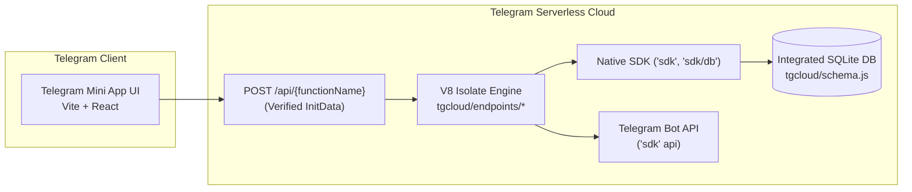
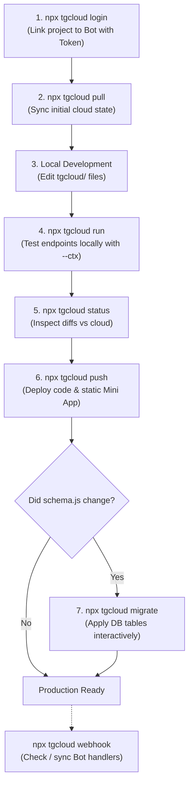

# Telegram Serverless Backend Guide — Dormshi

Welcome to the **Telegram Serverless (`tgcloud`)** backend development guide for Dormshi!

If you are coming from traditional Node.js backends (Express, NestJS, FastAPI) or serverless platforms (Vercel, AWS Lambda, Cloudflare Workers), this guide explains **how Telegram's serverless isolate platform works**, how our database and endpoints are structured, and the exact commands you need to build, test, migrate, and deploy.

> [!NOTE]
> Reference links:
> - Telegram Serverless Official Overview: [core.telegram.org/bots/serverless](https://core.telegram.org/bots/serverless)
> - Dormshi Schema Definition: [`tgcloud/schema.js`](file:///home/dagimafro/Documents/AntsarStudio/dormshi/tgcloud/schema.js)
> - Dormshi Database Design: [`docs/db.md`](file:///home/dagimafro/Documents/AntsarStudio/dormshi/docs/db.md)
> - Dormshi Endpoints Specification: [`docs/endpoints.md`](file:///home/dagimafro/Documents/AntsarStudio/dormshi/docs/endpoints.md)
> - Platform SDK Reference: [`docs/tgcloud-sdk.md`](file:///home/dagimafro/Documents/AntsarStudio/dormshi/docs/tgcloud-sdk.md)

---

## 1. Mental Model: What is Telegram Serverless?

In traditional web development, you run a server on `localhost:3000`, connect to PostgreSQL/MongoDB, install npm packages, and deploy a Docker container.

**Telegram Serverless is completely different:**



### Key Conceptual Differences
1. **Zero Local Server**: There is no Express or Node server running on your machine. All execution happens in serverless V8 isolates in Telegram's cloud.
2. **No `node_modules` at Runtime**: You cannot `npm install` packages for backend use. Only your project's `.js` files and the built-in platform SDK (`'sdk'`, `'sdk/db'`) exist inside the isolate.
3. **Built-in Authentication**: You never need JWTs, sessions, or custom HMAC signature verifiers. Telegram automatically verifies the Mini App caller's identity before executing your endpoint.
4. **Co-located Static Hosting**: Your frontend build folder (`dist`) is hosted directly by Telegram on the exact same domain as your serverless backend endpoints (`https://app<id>.tgcloud.ai/`).

---

## 2. Project Directory Layout

Everything executed in the cloud lives in the **`tgcloud/`** folder:

```
dormshi/
├── tgcloud/
│   ├── schema.js              # Database schema tables (SINGLE file)
│   ├── endpoints/             # Serverless functions (MUST BE FLAT)
│   │   ├── users.me.js
│   │   ├── orders.create.js
│   │   ├── orders.feed.js
│   │   └── ...
│   ├── handlers/              # Telegram Bot update handlers (message, callback_query)
│   │   └── message.js
│   └── lib/                   # Shared helper code (subdirectories allowed)
│       └── utils.js
├── tgcloud.jsonc              # Platform configuration (static site build folder)
├── src/                       # Frontend Mini App (React + Vite + Tailwind)
└── docs/                      # Project reference documentation
```

### Golden Rules That Bite Beginners
- **Flat Endpoints**: `tgcloud/endpoints/` cannot contain subdirectories (e.g. `endpoints/orders/create.js` is invalid). Always name files with dot notation: `orders.create.js`, `orders.feed.js`.
- **Always Include `.js` in Relative Imports**:
  - ✅ `import { users } from '../schema.js'`
  - ❌ `import { users } from '../schema'`
- **Import SDK by Name**:
  - ✅ `import { db, EndpointError } from 'sdk'`
  - ✅ `import { eq, sql } from 'sdk/db'`
- **Outside Code is Unreachable**: Your backend code inside `tgcloud/` cannot import anything from `src/` or `node_modules`.

---

## 3. Database Architecture (`tgcloud/schema.js`)

The platform includes an integrated SQLite database managed with a Drizzle-like schema query builder.

### 3.1. Defining Tables
All tables are defined in [`tgcloud/schema.js`](file:///home/dagimafro/Documents/AntsarStudio/dormshi/tgcloud/schema.js) as named exports:

```javascript
// tgcloud/schema.js
import {
  table,
  text,
  integer,
  real,
  boolean,
  json,
  index,
  uniqueIndex,
  check,
  sql
} from 'sdk/db';

export const users = table('users', {
  id: text('id').primaryKey(), // Generated via crypto.randomUUID()
  tgId: integer('tg_id').notNull(),
  name: text('name').notNull(),
  phone: text('phone'),
  campusId: text('campus_id').notNull(),
  isAmbassador: boolean('is_ambassador').default(false),
  mainBalance: real('main_balance').notNull().default(0.0),
  rating: real('rating').notNull().default(5.0),
  deliveriesCount: integer('deliveries_count').notNull().default(0),
  ordersCount: integer('orders_count').notNull().default(0),
  createdAt: integer('created_at', { mode: 'timestamp' }).default(sql`(unixepoch())`),
  updatedAt: integer('updated_at', { mode: 'timestamp' }).default(sql`(unixepoch())`),
}, (t) => ({
  tgIdUidx: uniqueIndex('uidx_users_tg_id').on(t.tgId),
  campusIdx: index('idx_users_campus_id').on(t.campusId),
  walletNonNegChk: check('chk_user_wallet_non_negative', sql`${t.mainBalance} >= 0.0`),
}));
```

### 3.2. Critical Database Rules
1. **NO Foreign Keys**:
   `.references()` and table `foreignKey()` **throw errors at runtime**. Telegram's isolate runs with SQLite foreign keys disabled. Enforce relational integrity in your endpoint application code.
2. **UUID Primary Keys**:
   Auto-increment integer IDs (`1, 2, 3...`) are strictly prohibited in Dormshi to prevent order volume guessing and ID enumeration attacks. Use `text('id').primaryKey()` and generate IDs with `crypto.randomUUID()`.
3. **Every Database Call is Async**:
   You **must always `await`** every query. Missing an `await` returns the builder object rather than database rows.
4. **Schema Drops Only via `.deprecated('reason')`**:
   Deleting a table or column from `schema.js` will **never** drop it from the cloud database. You must explicitly append `.deprecated('reason')` to drop columns safely.

---

## 4. Querying the Database (`sdk/db`)

### 4.1. Selecting Rows
```javascript
import { db } from 'sdk';
import { eq, and, desc, sql } from 'sdk/db';
import { orders, users } from '../schema.js';

// Get a single row:
const order = await db.select().from(orders).where(eq(orders.id, orderId)).get();

// Get multiple rows with pagination:
const results = await db.select()
  .from(orders)
  .where(and(eq(orders.campusId, campusId), eq(orders.status, 'open')))
  .orderBy(desc(orders.createdAt))
  .limit(20)
  .offset(0)
  .all();

// Count rows:
const totalCount = await db.$count(orders, eq(orders.campusId, campusId));
```

### 4.2. Common Comparison Operators
Imported from `'sdk/db'`:
- `eq(col, val)` — `=`
- `ne(col, val)` — `!=`
- `gt(col, val)` — `>`
- `gte(col, val)` — `>=`
- `lt(col, val)` — `<`
- `lte(col, val)` — `<=`
- `like(col, '%abc%')` — `LIKE`
- `inArray(col, [1, 2, 3])` — `IN (...)`
- `isNull(col)` / `isNotNull(col)`
- `and(...conditions)` / `or(...conditions)`

### 4.3. Inserting Rows
```javascript
const newOrderId = crypto.randomUUID();

await db.insert(orders).values({
  id: newOrderId,
  userId: callerUser.id,
  campusId: input.campusId,
  pickupLocation: input.pickupLocation,
  destination: input.destination,
  items: input.items, // JSON array automatically serialized
  status: 'open',
}).run();
```

### 4.4. Updating Rows
```javascript
await db.update(orders)
  .set({
    status: 'completed',
    updatedAt: sql`(unixepoch())`
  })
  .where(eq(orders.id, orderId))
  .run();
```

### 4.5. Atomic Wallet Mutations (Transactions / Math)
```javascript
// Increment or decrement numbers safely using sql template:
await db.update(users)
  .set({
    mainBalance: sql`${users.mainBalance} + ${earnedAmount}`,
    deliveriesCount: sql`${users.deliveriesCount} + 1`
  })
  .where(eq(users.id, courierId))
  .run();
```

---

## 5. Writing Serverless Endpoints (`tgcloud/endpoints/`)

Every endpoint is an ES module exporting a default `async function(input, ctx)`.

### 5.1. Anatomy of an Endpoint
```javascript
// tgcloud/endpoints/orders.get.js
import { db, EndpointError } from 'sdk';
import { eq } from 'sdk/db';
import { orders, offers } from '../schema.js';

export default async function (input, ctx) {
  // 1. Authenticated User from verified Telegram initData:
  const tgUser = ctx.initData.user; // e.g. { id: 12345678, first_name: "Maya" }

  // 2. Validate Input:
  const { orderId } = input;
  if (!orderId) {
    throw new EndpointError('orderId is required.', { code: 'INVALID_INPUT' });
  }

  // 3. Query the Database:
  const order = await db.select().from(orders).where(eq(orders.id, orderId)).get();
  if (!order) {
    throw new EndpointError('Order not found.', { code: 'ORDER_NOT_FOUND' });
  }

  const orderOffers = await db.select().from(offers).where(eq(offers.orderId, orderId)).all();

  // 4. Return JSON response:
  return {
    result: {
      order,
      offers: orderOffers
    }
  };
}
```

### 5.2. Deep Dive: The `input` Argument

The `input` argument contains the parsed JSON payload sent by your Mini App frontend via `Telegram.WebApp.Serverless.call(functionName, payload, callback)`.

#### 1. Characteristics of `input`:
- **Always an object**: Even if the frontend passes `null`, `undefined`, or calls without payload, `input` defaults to a plain object `{}`.
- **Pure JSON**: Only supports standard JSON types: `string`, `number`, `boolean`, `array`, `object`, and `null`. Functions, Date objects, or circular references cannot be passed.
- **Untrusted by default**: Never trust `input` blindly. Clients can forge requests or send malformed data.

#### 2. Best Practices for Validating `input`:
```javascript
export default async function (input, ctx) {
  // Destructure expected fields:
  const { orderId, rating, comment } = input;

  // 1. Check required fields:
  if (!orderId || typeof orderId !== 'string') {
    throw new EndpointError('orderId is required and must be a string.', {
      code: 'INVALID_ORDER_ID'
    });
  }

  // 2. Validate ranges and types:
  if (rating !== undefined && (typeof rating !== 'number' || rating < 1 || rating > 5)) {
    throw new EndpointError('Rating must be an integer between 1 and 5.', {
      code: 'INVALID_RATING',
      received: rating
    });
  }

  // 3. Clean and sanitize strings:
  const cleanComment = comment ? String(comment).trim().slice(0, 500) : null;

  // ... continue endpoint execution
}
```

---

### 5.3. Deep Dive: The `ctx` (Context) Argument

The `ctx` object is injected by Telegram's serverless isolate engine. It provides the **verified security context and runtime environment** for the execution.

#### 1. What `ctx.initData` Contains
In an endpoint (`tgcloud/endpoints/*.js`), `ctx.initData` contains the cryptographically verified user identity extracted from the Telegram Mini App initialization string:

```javascript
ctx.initData = {
  // The authenticated caller:
  user: {
    id: 12345678,               // Verified numeric Telegram User ID (TRUSTED)
    first_name: "Maya",         // Telegram profile first name
    last_name: "Okafor",        // Telegram profile last name (optional)
    username: "maya_okafor",    // Telegram @username handle (optional)
    language_code: "en",        // User's Telegram language setting
    is_premium: true            // Whether the user has Telegram Premium (optional)
  },

  // Deep-linking parameter (if launched via t.me/bot?startapp=xyz):
  start_param: "ref_123",       // Optional string

  // Timestamp when Telegram signed the request:
  auth_date: 1729489200,

  // Signature hash verified by the platform:
  hash: "a1b2c3d4e5f6..."
}
```

> [!IMPORTANT]
> **Zero HMAC Boilerplate**:
> In traditional Telegram bot development, you have to compute HMAC-SHA256 signatures with your bot token to verify `window.Telegram.WebApp.initData`.
> In `tgcloud`, **Telegram verifies this before your endpoint runs**. If someone makes a forged HTTP request without valid Telegram init data, the platform immediately rejects it with `401 Unauthorized`. Your endpoint code will never even execute!

> [!WARNING]
> **Common Trap — There is NO `ctx.user`**:
> A frequent beginner mistake is writing:
> ```javascript
> // ❌ WRONG: ctx.user does NOT exist!
> const userId = ctx.user.id; // Throws TypeError: Cannot read properties of undefined
>
> // ✅ CORRECT: Access via ctx.initData.user
> const userId = ctx.initData.user.id;
> ```

#### 2. Difference Between Endpoints and Handlers:
Notice how the arguments differ based on what is invoking your code:

| Type | Directory | Arguments | First Argument (`input` / `payload`) | Second Argument (`ctx`) |
| :--- | :--- | :--- | :--- | :--- |
| **Mini App Endpoints** | `tgcloud/endpoints/<name>.js` | `(input, ctx)` | JSON body sent from Mini App | `ctx.initData` holds verified Mini App caller (`ctx.initData.user`) |
| **Bot Update Handlers** | `tgcloud/handlers/<type>.js` | `(payload, ctx)` | The update payload (`Message`, `CallbackQuery`) | `ctx.update` holds the full raw `Update` with `update_id` |

#### 3. Simulating `ctx` During Local Testing (`npx tgcloud run`)
When testing endpoints server-side via the CLI, you can simulate any user identity using the `--ctx` flag:

```bash
# Test as a regular student:
npx tgcloud run endpoints/users.me '{}' \
  --ctx '{ "initData": { "user": { "id": 12345678, "first_name": "Maya", "username": "maya_o" } } }'

# Test an order placement:
npx tgcloud run endpoints/orders.create '{"pickupLocation": "Tea Lab", "destination": "Hartley 3B", "items": [{"name": "Milk tea", "quantity": 1}]}' \
  --ctx '{ "initData": { "user": { "id": 12345678 } } }'
```

---

### 5.4. Error Handling (`EndpointError`)
To reject a request with a clear error message that the frontend can read:
```javascript
import { EndpointError } from 'sdk';

throw new EndpointError('Insufficient balance to accept offer.', {
  code: 'INSUFFICIENT_FUNDS',
  required: totalAmount,
  available: user.mainBalance
});
```
- **Returns**: HTTP `400` with:
  ```json
  {
    "ok": false,
    "error_type": "ENDPOINT_ERROR",
    "description": "Insufficient balance to accept offer.",
    "parameters": {
      "code": "INSUFFICIENT_FUNDS",
      "required": 135.0,
      "available": 50.0
    }
  }
  ```
- Any unhandled exception (e.g. `throw new Error(...)` or a syntax bug) returns generic HTTP `500` to prevent leaking internal stack traces.

---

## 6. Complete CLI Workflow: From Login to Production

The CLI is installed as a project dev-dependency. Run it via `npx tgcloud <command>` (or using the `npm run` shortcuts in `package.json`).



---

### 6.1. Step 1: Linking Your Environment (`npx tgcloud login`)

To link your local development environment to the **Dormshi** Telegram bot:

```bash
npx tgcloud login
```

- When prompted, paste the **Telegram Bot Token**.
  > [!NOTE]
  > **Bot Token**: Your team lead will provide you with the project's Telegram Bot token. Keep it private; never commit tokens to git.
- The CLI securely authenticates with Telegram Cloud and stores local session credentials inside `.tgcloud/` (which is already gitignored).

---

### 6.2. Step 2: Sync Cloud State (`npx tgcloud pull`)

Once logged in, bring your local repository in sync with the live cloud environment:

```bash
npx tgcloud pull
```

This verifies credentials, creates your local snapshot, and ensures your environment matches the cloud state.

---

### 6.3. Step 3: Inspect Changes (`npx tgcloud status`)

Before deploying or after making edits to endpoints and schema, check what changed:

```bash
npx tgcloud status
```

- Shows modified, added, or deleted files under `tgcloud/` compared to what is currently deployed in the cloud isolate.
- Shows whether your database schema in `tgcloud/schema.js` has pending unapplied migrations.

---

### 6.4. Step 4: Test Serverless Functions Locally (`npx tgcloud run`)

You do not need to open Telegram to test your endpoint logic. You can execute any module directly in the server-side runtime via the CLI:

```bash
# 1. Test profile bootstrap (passes mock verified initData):
npx tgcloud run endpoints/users.me '{}' \
  --ctx '{ "initData": { "user": { "id": 12345678, "first_name": "Maya" } } }'

# 2. Test placing a new order:
npx tgcloud run endpoints/orders.create \
  '{"pickupLocation": "Tea Lab", "destination": "Hartley 3B", "items": [{"name": "Boba tea", "quantity": 2}]}' \
  --ctx '{ "initData": { "user": { "id": 12345678 } } }'

# 3. Test wallet deposit with CBE Txn ID:
npx tgcloud run endpoints/wallet.deposit \
  '{"txnId": "FT2429402941"}' \
  --ctx '{ "initData": { "user": { "id": 12345678 } } }'
```

---

### 6.5. Step 5: Deploy Code & Mini App (`npx tgcloud push` / `npm run deploy`)

When your code is ready to publish to Telegram Cloud:

```bash
# Deploy code modules AND built Mini App frontend:
npm run deploy

# Or deploy just backend modules directly:
npx tgcloud push
```

- Uploads all `.js` modules under `tgcloud/` (`endpoints/`, `handlers/`, `lib/`, `schema.js`).
- Uploads the `dist/` build output folder as the hosted Mini App static website (configured in `tgcloud.jsonc`).
- Prints the live deployed Mini App URL (e.g. `https://app<id>.tgcloud.ai/`).

---

### 6.6. Step 6: Apply Database Migrations (`npx tgcloud migrate`)

> [!CAUTION]
> **Deploying code (`push`) NEVER modifies the live database.**
> When you edit `tgcloud/schema.js`, running `push` only uploads the code descriptor. You **MUST** run `migrate` to actually alter the SQLite database!

```bash
npx tgcloud migrate
```

- The CLI compares your deployed `schema.js` against the live SQLite tables in the cloud.
- Displays an interactive summary of tables, columns, indexes, and constraints to create or modify.
- Prompts you to confirm before executing the DDL changes safely.

---

### 6.7. Step 7: Webhook Diagnostics & Repair (`npx tgcloud webhook`)

Telegram automatically routes incoming bot updates (messages, callback buttons) to your `tgcloud/handlers/` files:

```bash
# Inspect webhook status and handler mapping:
npx tgcloud webhook

# Re-synchronize webhook if it ever drifts:
npx tgcloud webhook sync
```

---

### 6.8. CLI Command Quick Reference

| Command | Action | Frequency |
| :--- | :--- | :--- |
| `npx tgcloud login` | Authenticate CLI with your Bot Token | Once during initial project setup |
| `npx tgcloud pull` | Download cloud state and cached snapshot | After login or when teammate pushes |
| `npx tgcloud status` | View local file and schema diffs vs the cloud | Frequently during development |
| `npx tgcloud run <module> [args]` | Execute endpoint server-side with simulated `--ctx` | While developing and debugging logic |
| `npx tgcloud push` | Deploy modules and static build to cloud | Whenever publishing code |
| `npx tgcloud migrate` | Interactively apply `schema.js` migrations to SQLite | **Immediately after `push`** if schema changed |
| `npx tgcloud webhook` | Check webhook alignment with `handlers/*` | If bot messages are not reaching handlers |

---

## 7. Calling Endpoints from the Frontend Mini App

On the client side (`src/lib/api.ts`), the official `telegram-web-app.js` script handles sending verified init data automatically:

### 7.1. Client SDK Wrapper (`src/lib/api.ts`)
```typescript
// src/lib/api.ts
declare global {
  interface Window {
    Telegram?: {
      WebApp?: {
        Serverless?: {
          call: (
            functionName: string,
            input: any,
            callback: (err: any, result: any) => void
          ) => void;
        };
      };
    };
  }
}

export async function callFunction<T = any>(functionName: string, input: Record<string, any> = {}): Promise<T> {
  return new Promise((resolve, reject) => {
    const serverless = window.Telegram?.WebApp?.Serverless;
    if (!serverless) {
      reject(new Error('Telegram Serverless SDK not available'));
      return;
    }

    serverless.call(functionName, input, (err, result) => {
      if (err) {
        // err contains { message, type: 'ENDPOINT_ERROR', parameters }
        reject(err);
      } else {
        resolve(result as T);
      }
    });
  });
}
```

### 7.2. Calling in React Components
```typescript
import { useState, useEffect } from 'react';
import { callFunction } from '@/lib/api';

export function OrderFeed() {
  const [orders, setOrders] = useState([]);
  const [loading, setLoading] = useState(true);

  useEffect(() => {
    async function loadFeed() {
      try {
        const { results } = await callFunction('orders.feed', {
          campusId: '01928a34-1111-7f82-a392-cf90c102a111',
          page: 1,
          limit: 20
        });
        setOrders(results);
      } catch (err: any) {
        console.error('Failed to load feed:', err.message, err.parameters);
      } finally {
        setLoading(false);
      }
    }
    loadFeed();
  }, []);

  if (loading) return <div>Loading campus orders...</div>;

  return (
    <div>
      {orders.map((order) => (
        <div key={order.id}>{order.pickupLocation} → {order.destination}</div>
      ))}
    </div>
  );
}
```

---

## 8. Summary Checklist Before Submitting Code

Before creating a pull request or pushing backend changes:

- [ ] Authenticated via `npx tgcloud login` using the Bot Token provided by the team lead.
- [ ] Endpoints are in flat `tgcloud/endpoints/` named `{resource}.{function}.js`.
- [ ] All relative imports have the `.js` extension (`import ... from '../schema.js'`).
- [ ] No `npm` packages are imported inside `tgcloud/` modules.
- [ ] All database calls use `await`.
- [ ] Primary keys use `crypto.randomUUID()` strings (no auto-increment integers).
- [ ] No foreign keys (`.references()`) are declared in `schema.js`.
- [ ] Tested endpoint using `npx tgcloud run endpoints/<name>`.
- [ ] If `schema.js` changed, executed `npx tgcloud migrate` after `npx tgcloud push`.
